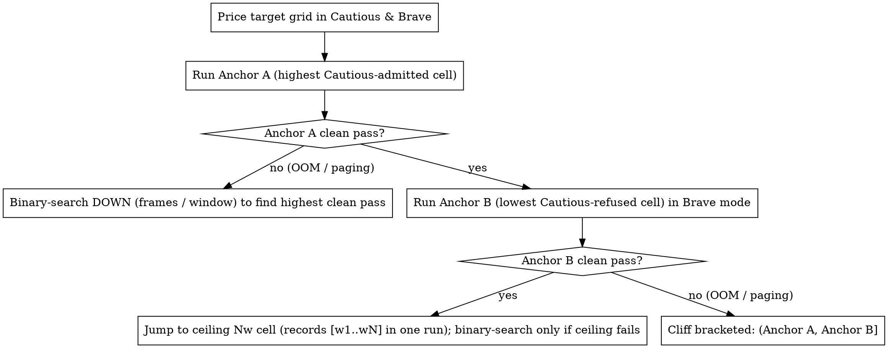

# Measuring Hardware Capability Cells Locally

## Overview

LTX Desktop decides what a local machine can generate, edit, or run with IC-LoRA using continuous token-based memory laws and measured-cell registries in `backend/runtime_config/`. This skill guides contributors and maintainers through pricing a hardware capability cell in code, instrumenting real runs on Windows/Linux (CUDA) or Apple Silicon (MPS), avoiding platform-specific allocator traps, binary-searching the true hardware cliff, and reporting reproducible results to improve the budget planner and compatibility docs.

### Related Documentation

| Document | Role |
| --- | --- |
| `docs/hardware-compatibility.md` | User-facing guide showing what each GPU and Mac tier runs in Cautious mode, priced directly from `backend/runtime_config/` |
| `docs/local-compat-matrix.md` | Generated tool × hardware-band matrix (`cd backend && uv run python -m runtime_config.local_compat_matrix`; never hand-edit) |
| `backend/performance_runner/README.md` | Headless backend performance harness (`pnpm perf:dev`), GPU/RAM samplers, and live regression scenarios |

> **Note for maintainers:** If your checkout includes the maintainer skill `maintaining-hardware-budgets` (`docs/skills/maintaining-hardware-budgets.md`), also follow its change-to-doc table when updating budget laws, floors, or measured-cell registries.

---

## 1. Anatomy of a Hardware Cell

A **hardware cell** is a specific combination of workflow, model, canvas geometry, frame count, execution strategy, and budget mode. Every axis below affects either the predicted memory ask or the admission verdict:

1. **Workflow / Feature (`BudgetFeature` in `runtime_config/measured_cells.py`)**:
   - **Fast (`fast`)**: Distilled text-to-video (T2V), image-to-video (I2V), and audio-to-video (A2V) (`decide_video_job`). All three modalities share one token law; single-pass and windowed runs price the heaviest stage-2 pass.
   - **Video Edit (`edit`)**: **Retake** (regenerate a segment inside a source clip) and **Extend** (generate new frames anchored to source context frames) (`decide_edit_job`). Retake and Extend share one single-pass token law (`tokens = (W / 32) * (H / 32) * latents`) plus a single-tile DiffVAE decode law on Windows. Edits **never** chunk or tile during denoising (`windows = 1`); instead, `max_edit_frames_that_load` binary-searches the longest frame window (up to `MAX_INPUT_FRAMES`) that fits the machine.
   - **IC-LoRA (`iclora`)**: Catalog video-to-video recipes (such as Day to Night, Water Simulation, Restore, Refine Details, Video Guide) and image-to-video **Ingredients** (`decide_ic_lora_job`, plus recipe frame caps via `IcLoraHandler.recipe_run_frames` and `POST /api/generations/ic-lora-recipes/{recipe_id}/memory`). Distinguishes `IcLoraStageMode` (`SINGLE_STAGE` vs `TWO_STAGE`), reference still count (`stills`), and full-res vs half-res reference adapters (`_HALF_RES_REF_IC_LORAS`).
2. **Model Version (`LTXLocalModelId`)**:
   - Resolved via `get_latest_ltx_model_id()` (or `ALL_LTX_LOCAL_MODEL_IDS` in `runtime_config/model_download_specs.py`). Any model ID not in `MEASURED_LOCAL_MODEL_IDS` is tagged `Extrapolated(basis="unmeasured_model")`.
3. **Resolution & Aspect Ratio (Real Canvas vs Priced Canvas)**:
   - Resolution labels in code and API requests are `"540p"`, `"720p"`, `"1080p"`, `"1440p"`, and `"2160p"` (**always use `"2160p"`, never `"4K"`, when calling budget or capability helpers**).
   - Aspect ratios: `"16:9"`, `"9:16"`, `"1:1"`, `"21:9"`, `"3:2"`, `"4:3"`, `"4:5"` (`"21:9"` is not offered at `"2160p"`).
   - **Real canvas**: `pixels_for(local_caps(model_id), resolution, aspect)` returns the actual `width x height` (snapped to the 64-px two-stage grid) that the pipeline executes.
   - **Priced canvas**: `budget_pixels(local_caps(model_id), resolution, aspect, mode="video")` returns the canvas the budget prices. Ratios narrower than `16:9` (`1:1`, `4:3`, `4:5`, `3:2`) are floored at the `16:9` anchor canvas so the duration picker stays consistent across shapes; wider or larger canvases (`21:9` everywhere, `9:16` at `1440p`) are priced at their own dimensions.
   - **Edit canvas**: Video edits letterbox the source onto a 32-px grid without upscaling (a native `2560x1440` source runs at `2560x1440`, whereas Fast `1440p` `16:9` runs at `2560x1472`).
4. **Duration, Frame Rate (`fps`), and the `8k + 1` Frame Grid**:
   - Pixel frames must sit on the causal VAE grid `8k + 1`: `frames = compute_num_frames(duration_s, fps)` (`frame_math.py`), producing `latents = (frames - 1) // 8 + 1` temporal latent frames.
   - Transformer sequence tokens for one pass of `F` pixel frames on canvas `W x H`:
     $$\text{seq} = \text{video\_tokens}(H, W, F) = \left(\frac{F - 1}{8} + 1\right) \times \frac{W}{32} \times \frac{H}{32}$$
   - `48` and `50` fps double `frames` (and `seq`) compared to `24` and `25` fps at the same duration.
5. **Execution Geometry (Load Mode, Temporal Chunking, Spatial/Decode Tiling)**:
   - **Load mode (`LoadMode`)**: `full_models_loading` (weights stay resident in VRAM) vs `streaming_models_loading` (weights stream layer-by-layer during each step via `OffloadMode.DISK` or `OffloadMode.CPU`; identical output pixels). Macs always use `streaming_models_loading` (`OffloadMode.DISK`).
   - **Single-pass vs Chunked Parts (`fast_chunking.py`, `ic_lora_chunking.py`)**:
     - Canvases at or above `CHUNKED_CANVAS_MIN_SHORT_SIDE` (`1440p` and `2160p`) longer than one window always run in overlapping temporal windows (`parts`). Canvases below `1440p` run in a single pass when it fits, and automatically step down into overlapping windows when a single pass exceeds the device ceiling (`_windows_help`).
     - `window_candidates(W, H)` lists valid `8k + 1` window lengths from longest (capped by `MAX_WINDOW_TOKENS`) down to `MIN_WINDOW_FRAMES`. Consecutive windows overlap by `CARRY_FRAMES` (Fast) or `ic_lora_carry_frames(tiling)` (IC-LoRA).
     - Window count is `windows = job_window_count(frames, chunk_pixel_frames, carry_frames)`, and the final window runs `last_window_frames(frames, chunk_pixel_frames, carry_frames)` frames.
     - In multi-window runs, peak memory rises from Window 1 (`w1`) to Window 2 (`w2`, which carries overlap state from Window 1) and plateaus from Window 3 (`PEAK_PLATEAU_WINDOWS`) onward (`w3..wN`).
   - **Spatial & Decode Tiling (`ic_lora_tiling.py`, `ic_lora_high_res.py`, `ic_lora_decode_window.py`)**:
     - Tiled IC-LoRAs (Restore, Refine Details, and any recipe at `1440p`/`2160p` with `highResVideoToVideo` enabled) run denoising one spatial tile at a time (`transformer_pass_size`), then run DiffVAE decode over the full canvas (using `choose_decode_window` and `diffvae_decode_vram` to tile decode).
6. **Budget Mode (`cautious` vs `brave`) and Pass Shape (`auto`, `one_pass`, `parts`)**:
   - **Cautious (`"cautious"`)**: Admits only cells that fit the memory budget AND have measured coverage (`Fitted`, or covered by the device's local `DeviceCalibration` frontier). Refuses `stream_over`, `ram_shortfall`, and `unmeasured_cell`.
   - **Brave (`"brave"`)**: Allows `stream_over`, `ram_shortfall`, and `unmeasured_cell` as confirmable `GenerationRisk` bets (`tier="over"` or `tier="unmeasured"`). Brave never bypasses hard walls (`unsupported`, `mps_sequence_over`, `one_pass_unavailable`, `spatial`, `refine_decode_floor`).

---

## 2. Pre-Flight & Machine Hygiene

Before running any measurement cell, standardize the host environment so runs are reproducible and free of background noise:

1. **Record the hardware & software baseline**:
   - Capture OS/kernel build, GPU model or Apple Silicon chip, GPU driver version, exact total and idle-free VRAM bytes (`torch.cuda.mem_get_info(0)`) or macOS total RAM + Metal pool (`torch.mps.recommended_max_memory()`), total and available system RAM, storage bus type for the checkpoint directory (`nvme`, `ssd`, `hdd`), Python, `torch`, `ltx-core`, and `ltx-pipelines` versions, active `model_id`, and attention backend (`SageAttention` on CUDA; `picked=mpsgraph_zc active=True` on Apple Silicon).
2. **Close background GPU and memory consumers**:
   - On CUDA, execution-time admission gates on `min(total_vram, free_vram)`. Browsers, Electron apps, video editors, or secondary monitors occupying 1–3 GiB of VRAM will both trigger premature `stream_over` refusals (or edit-window shrinking) and cause early WDDM paging. Prefer running against the headless backend (`pnpm perf:dev`).
   - On Linux laptops with hybrid GPUs, verify whether the desktop display server is hosted on the iGPU or the NVIDIA dGPU (`nvidia-smi` `Display Active`).
3. **Prevent system sleep and power throttling**:
   - Keep laptops plugged into AC power with high/normal performance mode enabled (Low Power Mode off).
   - **macOS**: Run `caffeinate -dimsu -t <seconds>` in a separate terminal and verify with `pmset -g assertions | grep -i prevent`.
   - **Windows**: Prevent sleep via PowerShell `SetThreadExecutionState(0x80000003)` for the duration of the sweep.
   - **Linux**: Wrap long sweeps in `systemd-inhibit --what=idle:sleep`.
4. **Distinguish Cold-Start vs Warm Steady-State runs**:
   - **Cold run (required for peak memory / edge measurements)**: Launch a fresh backend process per cell so cached allocator blocks or fragmentation from a previous cell cannot skew Window 1 peaks. When benchmarking loader I/O (`load_s`), also empty the OS standby/page cache before starting (`RAMMap64.exe -accepteula -Et` on Windows; `sudo purge` on macOS).
   - **Warm run (for steady-state throughput & retention soak)**: Run subsequent jobs in the same backend process to measure warm step time (`s/step`), stage-cache speedups, or multi-job memory retention (running a cell 5–10 times back-to-back in `soak_test.py` to confirm inter-job VRAM and RSS return to a flat floor).
   - **Deterministic payload controls**: Fix `seed: 42`, use a constant prompt with prompt rewrite bypassed (`promptProvenance: "enhanced"`), and keep `Torch Compile` off unless specifically testing compilation.

---

## 3. How to Price a Cell Before Running

Never guess or hardcode expected GiB numbers—laws and constants move when refit. Always query `runtime_config` directly from `backend/` to inspect what the planner predicts for your live machine or any target hardware tier:

```bash
cd backend && UV_FROZEN=1 uv run python - <<'EOF'
import importlib.metadata
import json
import platform
from pathlib import Path

import torch

from frame_math import compute_num_frames
from runtime_config.accelerator import accelerator_supports_fp8
from runtime_config.budget_admission import Admitted
from runtime_config.device_calibration import CALIBRATION_EPOCH
from runtime_config.fast_chunking import CARRY_FRAMES, job_window_count, last_window_frames
from runtime_config.ic_lora_chunking import ic_lora_carry_frames
from runtime_config.ic_lora_high_res import high_res_tiling
from runtime_config.ic_lora_job_budget import (
    HOME_IC_LORA_PREVIEW_SETTINGS,
    catalog_preview_stage1,
    decide_ic_lora_job,
)
from runtime_config.ic_lora_stage_mode import IcLoraStageMode
from runtime_config.ic_lora_tiling import IcLoraTiling
from runtime_config.local_runtime import resolve_local_runtime
from runtime_config.ltx_capabilities import budget_pixels, local_caps, pixels_for
from runtime_config.macos_version import detect_macos_major
from runtime_config.model_download_specs import get_latest_ltx_model_id
from runtime_config.reject_reasons import BudgetMode, PassShape
from runtime_config.runtime_policy import decide_local_generation_mode
from runtime_config.video_job_budget import (
    NOMINAL_MPS_POOL_RATIO,
    HardwareProfile,
    LocalJobFilter,
    MemoryBudget,
    decide_edit_job,
    decide_video_job,
    mac_disk_stream_host_gib,
    max_edit_frames_that_load,
    memory_gb_for_job,
    video_tokens,
)
from services.gpu_info.gpu_info_impl import GpuInfoImpl
from services.retake_pipeline.window import MAX_INPUT_FRAMES
from services.storage_info.storage_info import DriveType
from services.storage_info.storage_info_impl import StorageInfoImpl

GIB = 1024**3
MODEL = get_latest_ltx_model_id()
CAPS = local_caps(MODEL)


def live_filter(
    *,
    mode: BudgetMode = "cautious",
    pass_shape: PassShape = "auto",
    total_only: bool = False,
    checkpoint_dir: Path | str = Path.home(),
) -> tuple[LocalJobFilter, dict[str, object]]:
    """Build a LocalJobFilter from the current machine's live GPU/MPS/RAM probes."""
    gpu = GpuInfoImpl()
    storage = StorageInfoImpl(checkpoint_dir)
    sys_raw = platform.system()
    system = sys_raw if sys_raw in ("Windows", "Darwin") else "Linux"
    rt = resolve_local_runtime(
        gpu,
        system=system,
        fp8_capable=accelerator_supports_fp8(),
        storage_info=storage,
        macos_major=detect_macos_major(),
    )
    free_vram = gpu.get_free_cuda_vram_bytes()
    mps_pool = gpu.get_mps_pool_bytes()
    jf = LocalJobFilter(
        profile=HardwareProfile(
            system=system,  # type: ignore[arg-type]
            model_id=MODEL,
            process_mode=rt.mode,
            drive_type=rt.checkpoint_drive_type,
            fp8_capable=rt.fp8_capable,
        ),
        budget=MemoryBudget(
            total_vram_bytes=rt.vram_bytes,
            free_vram_bytes=free_vram,
            total_ram_bytes=rt.total_ram_bytes,
            memory_gb=memory_gb_for_job(
                vram_gb=rt.vram_gb,
                available_ram_gb=rt.available_ram_gb,
                darwin=rt.darwin,
            ),
            mps_pool_bytes=mps_pool,
            total_only=total_only,
        ),
        budget_mode=mode,
        pass_shape=pass_shape,
    )
    meta = {
        "system": system,
        "os_release": platform.release(),
        "gpu_model": rt.gpu_device_name,
        "process_mode": rt.mode,
        "vram_total_gib": round(rt.vram_bytes / GIB, 2) if rt.vram_bytes else None,
        "vram_free_gib": round(free_vram / GIB, 2) if free_vram else None,
        "mps_pool_gib": round(mps_pool / GIB, 2) if mps_pool else None,
        "mac_loader_host_gib": round(mac_disk_stream_host_gib(MODEL), 2) if rt.darwin else None,
        "ram_total_gib": round(rt.total_ram_bytes / GIB, 2) if rt.total_ram_bytes else None,
        "drive_type": rt.checkpoint_drive_type,
        "fp8_capable": rt.fp8_capable,
        "torch": torch.__version__,
        "ltx_core": importlib.metadata.version("ltx-core"),
        "ltx_pipelines": importlib.metadata.version("ltx-pipelines"),
        "model_id": MODEL,
        "calibration_epoch": CALIBRATION_EPOCH,
    }
    return jf, meta


def band_filter(
    system: str,
    gib: float,
    *,
    ram_gb: int = 64,
    free_gib: float | None = None,
    mode: BudgetMode = "cautious",
    pass_shape: PassShape = "auto",
    drive_type: DriveType | None = "nvme",
) -> LocalJobFilter:
    """Build a LocalJobFilter for any simulated GPU (gib=VRAM) or Mac (gib=unified RAM)."""
    darwin = system == "Darwin"
    vram_int = None if darwin else int(gib)
    ram_int = int(gib) if darwin else ram_gb
    process_mode = decide_local_generation_mode(
        system,
        not darwin,
        vram_int,
        mps_available=darwin,
        ram_gb=ram_int,
        macos_major=26 if darwin else None,
    )
    total_vram_bytes = None if darwin else int(gib * GIB)
    free_vram_bytes = (
        None
        if darwin
        else (int(free_gib * GIB) if free_gib is not None else total_vram_bytes)
    )
    return LocalJobFilter(
        profile=HardwareProfile(
            system=system,  # type: ignore[arg-type]
            model_id=MODEL,
            process_mode=process_mode,
            drive_type=None if darwin else drive_type,
        ),
        budget=MemoryBudget(
            total_vram_bytes=total_vram_bytes,
            free_vram_bytes=free_vram_bytes,
            total_ram_bytes=ram_int * GIB,
            memory_gb=memory_gb_for_job(
                vram_gb=vram_int, available_ram_gb=ram_int, darwin=darwin
            ),
            mps_pool_bytes=int(ram_int * GIB * NOMINAL_MPS_POOL_RATIO) if darwin else None,
            total_only=(free_gib is None),
        ),
        budget_mode=mode,
        pass_shape=pass_shape,
    )


def price_fast(
    jf: LocalJobFilter, res: str, aspect: str, duration_s: int, fps: int = 24
) -> dict[str, object]:
    w_priced, h_priced = budget_pixels(CAPS, res, aspect, mode="video")
    w_real, h_real = pixels_for(CAPS, res, aspect)
    frames = compute_num_frames(duration_s, fps)
    adm = decide_video_job(w_priced, h_priced, frames, job_filter=jf)
    chunk_f = adm.priced.chunk_pixel_frames
    windows = job_window_count(frames, chunk_f, CARRY_FRAMES)
    last_f = last_window_frames(frames, chunk_f, CARRY_FRAMES) if chunk_f else frames
    return {
        "cell": f"fast {res} {aspect} {duration_s}s@{fps}fps ({frames}f)",
        "mode": jf.budget_mode,
        "canvas_real": f"{w_real}x{h_real}",
        "canvas_priced": f"{w_priced}x{h_priced}",
        "admitted": isinstance(adm, Admitted),
        "verdict": adm.load.mode if isinstance(adm, Admitted) else adm.reject.reason,
        "stream_gib": round(adm.priced.stream_gib, 2),
        "full_gib": round(adm.priced.full_gib, 2),
        "windows": windows,
        "window_frames": chunk_f or frames,
        "last_window_frames": last_f,
        "seq_priced": int(adm.priced.seq),
        "tokens_real": int(video_tokens(h_real, w_real, chunk_f or frames)),
        "evidence": type(adm.priced.evidence).__name__,
        "risk": (
            f"{adm.risk.tier}:{adm.risk.unmeasured_basis or adm.risk.shortfall_kind}"
            if isinstance(adm, Admitted) and adm.risk
            else ("none" if isinstance(adm, Admitted) else (adm.bet.tier if adm.bet else "hard_wall"))
        ),
    }


def price_edit(
    jf: LocalJobFilter, width: int, height: int, frames: int | None = None
) -> dict[str, object]:
    target_f = (
        frames
        if frames is not None
        else max_edit_frames_that_load(width, height, frame_cap=MAX_INPUT_FRAMES, job_filter=jf)
    )
    adm = decide_edit_job(width, height, target_f, job_filter=jf)
    return {
        "cell": f"edit {width}x{height} ({target_f}f)",
        "mode": jf.budget_mode,
        "admitted": isinstance(adm, Admitted),
        "max_frames": target_f if isinstance(adm, Admitted) else 0,
        "max_seconds_24fps": round((target_f - 1) / 24, 2) if isinstance(adm, Admitted) else 0.0,
        "verdict": adm.load.mode if isinstance(adm, Admitted) else adm.reject.reason,
        "stream_gib": round(adm.priced.stream_gib, 2),
        "seq": int(adm.priced.seq),
        "evidence": type(adm.priced.evidence).__name__,
    }


def price_iclora(
    jf: LocalJobFilter,
    stage1_w: int,
    stage1_h: int,
    duration_s: int,
    *,
    fps: int = 24,
    ic_lora_id: str = "day-to-night",
    stage_mode: IcLoraStageMode = IcLoraStageMode.SINGLE_STAGE,
    tiling: IcLoraTiling | None = None,
    stills: int = 0,
) -> dict[str, object]:
    frames = compute_num_frames(duration_s, fps)
    adm = decide_ic_lora_job(
        stage1_w,
        stage1_h,
        frames,
        stage_mode=stage_mode,
        job_filter=jf,
        ic_lora_id=ic_lora_id,
        stills=stills,
        tiling=tiling,
    )
    chunk_f = adm.priced.chunk_pixel_frames
    carry_f = ic_lora_carry_frames(tiling)
    windows = job_window_count(frames, chunk_f, carry_f)
    return {
        "cell": f"iclora:{ic_lora_id} {stage1_w}x{stage1_h} {duration_s}s@{fps}fps ({frames}f)",
        "mode": jf.budget_mode,
        "admitted": isinstance(adm, Admitted),
        "verdict": adm.load.mode if isinstance(adm, Admitted) else adm.reject.reason,
        "stream_gib": round(adm.priced.stream_gib, 2),
        "windows": windows,
        "window_frames": chunk_f or frames,
        "tiled": tiling is not None,
        "seq": int(adm.priced.seq),
        "evidence": type(adm.priced.evidence).__name__,
    }


_, host_meta = live_filter()
print("Host profile:", json.dumps(host_meta, indent=2))

for mode in ("cautious", "brave"):
    win16 = band_filter("Windows", 16, mode=mode)
    print(price_fast(win16, "1440p", "16:9", 10, 24))
    print(price_edit(win16, 1920, 1088))
    print(
        price_iclora(
            win16,
            2560,
            1472,
            5,
            ic_lora_id="water-simulation",
            tiling=high_res_tiling(None),
        )
    )
EOF
```

- **Ingredients preview**: Pass `stage1_w, stage1_h = catalog_preview_stage1(HOME_IC_LORA_PREVIEW_SETTINGS)`, `stage_mode=HOME_IC_LORA_PREVIEW_SETTINGS.stage_mode`, and `ic_lora_id="ingredients"` (omitting `ic_lora_id` on macOS skips the Ingredients adapter term).
- **Home IC-LoRA video recipes**: To inspect the exact frame count a recipe runs after input-cap and budget trimming, query `POST /api/generations/ic-lora-recipes/{recipe_id}/memory` or call `IcLoraHandler.recipe_run_frames` (see `backend/tests/test_ic_lora_recipe_memory.py`).

---

## 4. How to Run and Instrument a Cell

### Running via the Local Backend

1. **Launch the backend**:
   - **Headless (preferred for measurements)**: Run `pnpm perf:dev` from the repo root. It starts the Python backend without Electron/Chromium GPU contention and opens the performance dashboard (`backend/performance_runner/README.md`).
   - **Manual Apple Silicon launch**: Always prepend `backend/.venv/bin` to `PATH` so `ninja` is available to build the zero-copy `mpsgraph_zc` attention extension:
     ```bash
     cd backend
     PATH="$PWD/.venv/bin:$PATH" LTX_APP_DATA_DIR=/tmp/ltx-meas LTX_PORT=41954 .venv/bin/python ltx2_server.py
     ```
2. **Select the right route and flags**:
   - Enable `highResVideoToVideo: true` in settings when testing `1440p` or `2160p` Video Edit (Retake/Extend) or IC-LoRA cells.
   - Submit `1440p` and `2160p` IC-LoRA recipes through the **queued Home recipe route** (`POST /api/generations/ic-lora-recipes/{recipe_id}`), which wires `high_res_settings` (`1440p`/`2160p` canvas and high-res spatial/temporal tiling).
   - Switch to **Brave mode** (`budget_mode: "brave"`) when probing cells just above the Cautious boundary (`stream_over` or `unmeasured_cell`).
3. **Account for Device Calibration (`runtime_config/device_calibration.py`)**:
   - At the end of every local generation, `CalibrationHandler.record_if_clean` runs `clean_run_verdict(identity, baseline, end)`:
     - **CUDA**: `"clean"` when reserved VRAM growth stayed within `baseline.free_vram_bytes - PAGING_MARGIN_BYTES` and `min_free_vram_bytes >= MIN_FREE_FLOOR_BYTES`; otherwise logs `"vram_growth"` or `"free_floor"`.
     - **Darwin**: `"clean"` when swap growth stayed within `SWAP_GROWTH_TOLERANCE_BYTES`; otherwise logs `"swap_growth"`.
   - A `"clean"` run writes a `FrontierPoint(seq, canvas_px, windows)` into `store.sqlite3` (`device_calibration_frontier` table) under `CALIBRATION_EPOCH` and logs:
     `[calibration] <gen_id> clean: <feature> seq=<seq> canvas=<px> windows=<w> (widened|already covered)`
   - **Calibration side effect during sweeps**: Once a Brave run is recorded as `clean`, any subsequent cell in the same `CalibrationBucket` with `(seq, canvas_px, windows)` all `<=` that point is marked `covered=True` and **admitted in Cautious mode without an `unmeasured_cell` refusal**. Record your Cautious pre-flight verdicts *before* executing Brave runs, or isolate runs with a scratch `LTX_APP_DATA_DIR`.

### Per-Phase Telemetry to Record

Inspect the backend session log (`<app_data_dir>/logs/`) and hardware samplers for four phases on every run:

| Phase | Log Markers & Probes | What to Record & Verify |
| --- | --- | --- |
| **0. Gate & Geometry Attestation** | `[video] job budget`, `[video-edit] job budget`, `[ic-lora] job budget`<br>`[hires-video] <W>x<H> in <N> window(s) of <F> frames (carry <C>)`<br>`[ic-lora] stage-1 ...` / `chunked: ...` / `tiled: ...` | Verify `seq`, `stream=<ask>GiB`, `window=<F>f`, real canvas `WxH`, and `OffloadMode.DISK` vs `CPU`. **Void the run** if the logged geometry does not match the target cell. |
| **1. Model Load & Text/Source Encode** | Job start → first denoise heartbeat | `load_s` (elapsed load + text/reference encode time) and `pre_window_peak_gib` (peak memory before Window 1 denoise starts, covering the text encoder, reference VAE encode, and any control preprocessors). |
| **2. Transformer Denoise Windows** | `[heartbeat] ... allocated=<A>GiB reserved=<R>GiB peak=<P>GiB free=<F>/<T>GiB alloc_retries=<N>` (CUDA)<br>`[heartbeat] ... torch=<T>GiB driver=<D>GiB max=<M>GiB \| sdpa: ...` (MPS)<br>`[hires-video] ... peak VRAM allocated <A> GiB, reserved <R> GiB` | Per-window peak series `per_window_peaks_gib = [w1, w2, ..., wN]`, whole-run `allocated` and `reserved` (or `driver`) peaks, and steady-state step time **`s/step`** (seconds per denoising step in stage 1 and stage 2). |
| **3. DiffVAE Decode & Export** | `DiffVAE CUDA tiling after evict: measured=<X> GiB budget=<Y> GiB <W>x<H>x<F> t/h/w tiles=<t>/<h>/<w>`<br>`DiffVAE MPS tiling clamp <W>x<H>x<F> t/h/w tiles=<t>/<h>/<w>` | `decode_s` (time from last denoise step to job completion), `post_window_peak_gib` (decode/stitch/export peak), verbatim decode tiling line, and `oom_phase` (`encode`, `denoise-w<k>`, `decode`, `stitch`, `export`) if the run failed. |

---

## 5. Platform-Specific Measurement Traps

### Windows & Linux (CUDA)

1. **`cuda_max_allocated` vs `cuda_max_reserved` — Never cap reserved-law runs**:
   - `cuda_max_allocated` tracks active tensor bytes and predicts hard `CUDA out of memory` crashes.
   - `cuda_max_reserved` tracks the PyTorch caching allocator's physical segment footprint and predicts **WDDM paging** on Windows.
   - **Trap**: Do **not** set `torch.cuda.set_per_process_memory_fraction` or `PYTORCH_CUDA_ALLOC_CONF=max_split_size_mb:...` when measuring Windows reserved memory laws. A virtual cap forces PyTorch to flush cached segments whenever reservations approach the cap, making `cuda_max_reserved` artificially hug the cap while `cuda_max_allocated` stays constant—destroying the native reserved signal.
   - **Rule**: Run **native (uncapped)** when measuring reserved laws. Use `torch.cuda.set_per_process_memory_fraction` on a large GPU *only* when testing whether `cuda_max_allocated` and post-evict DiffVAE decode tiling (`resolve_cuda_decode_tiling_retry`) survive inside a simulated smaller card's hard ceiling.
   - In `full_models_loading` mode, `cuda_max_allocated` can sit flat across small and medium token counts (dominated by resident weights) while `cuda_max_reserved` climbs with tokens. Always record both metrics.
2. **Silent WDDM Shared-Memory Paging (`s/step` blow-up without OOM)**:
   - On Windows (WDDM), when a job's working set exceeds physical free VRAM, the OS driver silently spills GPU pages into **Shared GPU Memory** (system RAM over PCIe) instead of raising `CUDA out of memory`.
   - **Symptoms**: The job does not crash—it finishes very slowly or appears to stall while per-step denoise time (`s/step`) blows up **3x–10x+** and `alloc_retries` in `[heartbeat]` climbs as `cudaMalloc` thrashes the cache.
   - **Rule**: Sample Windows **Shared GPU Memory** (Task Manager / `typeperf`) alongside `s/step` and `[heartbeat]` `free` / `alloc_retries`. If Shared GPU usage rises > 0.5 GB above idle baseline, `s/step` inflates 3x–10x, or calibration logs `vram_growth` / `free_floor`, record the outcome as **`paging-slowdown`** (a failed capacity point), **never** as `pass`.
3. **NVMe Disk-Streaming vs CPU Offload & Host RAM**:
   - On Windows, `windows_checkpoint_streams_from_disk` routes NVMe volumes to `OffloadMode.DISK` and non-NVMe volumes to `OffloadMode.CPU` (each gated by its own system RAM floor in `video_job_budget.py`).
   - Confirm from the backend log which offload mode ran, and monitor process `PeakWorkingSet64` and commit charge. If `OffloadMode.DISK` throughput is unexpectedly slow on Windows NVMe, check whether Windows Defender real-time protection is scanning the checkpoint directory on positional reads (`LTX_LOADER_READ_WORKERS`).

### Apple Silicon Mac (MPS / Unified Memory)

1. **Unified Memory Pool Ceiling & Loader Host Buffers (`mac_disk_stream_host_gib`)**:
   - Macs gate local jobs against the Metal allocator ceiling `torch.mps.recommended_max_memory()` (`get_mps_pool_bytes()`, roughly `NOMINAL_MPS_POOL_RATIO` of total unified RAM).
   - Alongside MPS tensors, the disk-streaming weight loader allocates ordinary host-memory read buffers and staging buckets **outside** the MPS allocator (`mac_disk_stream_host_gib(model_id)`). Because CPU and GPU share unified memory, `decide_mac_job` adds `mac_disk_stream_host_gib(model_id)` on top of the MPS allocator curve so `stream_gib` reflects total unified-memory demand.
2. **Native Driver Cache vs Capped Edge Brackets (`(F, P]`)**:
   - **Trap**: Never compare an uncapped (native) Mac `driver_allocated_memory()` peak directly to `stream_gib`. On an uncapped pool, the Metal driver retains several GiB of lazy buffer cache above the true minimum working set.
   - **Rule**: Use a native uncapped run only to observe the relative per-window step shape `[w1, w2, ..., wN]`. To measure the true Mac memory requirement of a cell (an **edge law**), bracket the MPS allocator in a fresh backend process per cap using:
     ```python
     pool_gib = torch.mps.recommended_max_memory() / (1024**3)
     torch.mps.set_per_process_memory_fraction(cap_gib / pool_gib)
     ```
   - Find the lowest passing cap `P` (completes with valid, non-flat frames) and the highest failing cap `F` just below `P` (HTTP 500 / Metal `Tried to allocate` OOM), establishing the allocator bracket `(F, P]`. When comparing an allocator cap `cap_gib` to `decide_mac_job`'s `stream_gib`, add `mac_disk_stream_host_gib(model_id)` to the allocator edge.
3. **macOS Swap / Compressor Thrashing & Attention Leak Tripwire**:
   - When unified memory is over-committed, macOS compresses pages (`cmprs` in `top` / `vm_stat`) and swaps to SSD (`sysctl -n vm.swapusage`) instead of raising a Metal OOM, causing `s/step` to balloon. Monitor `sysctl -n vm.swapusage` and `memory_pressure`; if swap grows past `SWAP_GROWTH_TOLERANCE_BYTES` or thrashing occurs, abort and record **`paging-slowdown`** (`fail-swap`), not `pass`.
   - Verify the first `[heartbeat]` line prints `picked=mpsgraph_zc active=True`. If `driver` climbs ~2 GiB every 15 s while `torch` stays flat, the fallback attention path is leaking because `ninja` was not on `PATH`—abort and fix `PATH` before measuring.

---

## 6. Designing a Cell Sweep (Binary-Searching the Cliff)

Do not brute-force every `(resolution × aspect × fps × duration)` combination. Use the budget predictor and invariant transfers to locate the true boundary in a few anchor runs:



1. **Pick Anchor A and Anchor B from the pricing script**:
   - **Anchor A**: Highest duration / frame count at the target resolution admitted in `cautious` mode.
   - **Anchor B**: Lowest duration / frame count refused in `cautious` mode (`stream_over` or `unmeasured_cell`) that `brave` mode admits.
2. **Exploit multi-window series capture**:
   - Never run separate `1w`, `2w`, `3w`, `4w`, and `5w` jobs at the same window size. A single `Nw` run logs `[w1, w2, ..., wN]`, giving the 1-window base (`w1`), the 2-window step (`w2`), and the `>=3`-window plateau (`w3..wN`) in one execution.
3. **Exploit modality and aspect-ratio invariance**:
   - **Modality**: Measure the full token curve on Fast T2V, then run at most one high-window spot-check on I2V and A2V to confirm zero conditioning surcharge. For Video Edit, test one same-token Retake vs Extend pair.
   - **Aspect ratio**: Measure `16:9` as the anchor. Spot-check at most one **Class A** orientation twin (`9:16` at `1080p` or `2160p`, identical tokens to `16:9`), one **Class B** own-window portrait (`9:16` at `1440p`), one **Class C** smaller square (`1:1`), and one **Class D** ultrawide (`21:9`). `3:2`, `4:3`, and `4:5` ride the `1:1` Class C result.

---

## 7. Reporting & Contributing Results

### Reproducible Measurement Report Template

Include only text tables and JSONL records in issues or pull requests—never commit `.mp4` outputs, source clips, PNG frames, or raw multi-megabyte log files.

#### Hardware & Runtime Profile (`runtime.json` / PR header)

| Field | Value |
| --- | --- |
| **OS & Build** | e.g., Windows 11 (`10.0.26100`), macOS (`26.x`), Linux kernel (`6.x`) |
| **GPU / Apple Silicon Chip** | e.g., NVIDIA GeForce RTX 4080 / Apple M4 Max |
| **VRAM (Total / Idle Free) or MPS Pool** | `<total_gib> GiB` / `<free_gib> GiB` (or MPS pool `<pool_gib> GiB` + loader host `<host_gib> GiB`) |
| **System RAM & Drive Type** | `<ram_gib> GiB` / `<nvme \| ssd \| hdd>` |
| **Driver / PyTorch / LTX Versions** | Driver `<ver>`, `torch <ver>`, `ltx-core <ver>`, `ltx-pipelines <ver>` |
| **Model ID & Offload Mode** | `<model_id>`, `OffloadMode.<DISK \| CPU \| NONE>`, Attention `<sage \| mpsgraph_zc>` |

#### Cell Sweep Summary Table

| Cell ID | Workflow & Mode | Res / Aspect (`WxH` real) | Duration / Frames (`fps`) | Pass Shape (`windows x win_f`, carry, last) | Predicted Ask (`stream_gib`) | Measured Peak (`reserved` / `alloc` or `driver` + cap bracket) | Per-Window Peaks `[w1..wN]` | Pre / Post Decode (`GiB`) | Step Time (`s/step`) | Shared GPU or Swap Delta | Calibration Verdict | Outcome (`oom_phase`) |
| --- | --- | --- | --- | --- | --- | --- | --- | --- | --- | --- | --- | --- |
| `<id>` | `fast-t2v` (`brave`) | `1440p` `16:9` (`<WxH>`) | `10s` / `<frames>f` (`24`) | `<N>w x <F>f` (`c<carry>`, `last <L>f`) | `<ask> GiB` | `<res> / <alloc> GiB` | `[<w1>, ..., <wN>]` | `<pre> / <post>` | `<s_s1> / <s_s2> s` | `<delta> GB` | `clean` | `pass` (`-`) |

Valid `Outcome` values:
- `pass`: Completed with valid visual frames, no WDDM paging (`shared_delta <= 0.5 GB`) or macOS swap growth, steady `s/step`, and `clean` calibration verdict.
- `paging-slowdown`: Completed or killed after WDDM shared-memory spill (`> 0.5 GB`) or macOS swap thrashing caused a 3x–10x+ `s/step` blow-up (`vram_growth`, `free_floor`, or `swap_growth`).
- `oom`: Failed with CUDA or Metal `Tried to allocate` / `out of memory` (`oom_phase` = `encode`, `denoise-w<k>`, `decode`, `stitch`, or `export`).
- `refusal`: Refused pre-run by the budget gate (record HTTP 422 code and `reject.reason`).

#### Per-Run JSONL Schema (`records.jsonl`)

Populate the geometry and predicted fields from the Section 3 pricing script and the measured fields from the backend log and hardware samplers:

```json
{
  "id": "fast-1440p-16x9-10s-24fps",
  "feature": "fast",
  "modality": "t2v",
  "model_id": "<from get_latest_ltx_model_id()>",
  "budget_mode": "brave",
  "resolution_label": "1440p",
  "aspect_ratio": "16:9",
  "canvas_real": "<WxH from pixels_for>",
  "canvas_priced": "<WxH from budget_pixels>",
  "duration_s": 10,
  "fps": 24,
  "frames": 241,
  "windows": 2,
  "window_frames": 129,
  "last_window_frames": 129,
  "carry_frames": 17,
  "tiled": false,
  "seq_priced": 62560,
  "tokens_real": 62560,
  "predicted_stream_gib": 0.0,
  "cap_gib": null,
  "measured_reserved_peak_gib": 0.0,
  "measured_alloc_peak_gib": 0.0,
  "mps_driver_peak_gib": null,
  "per_window_peaks_gib": [],
  "pre_window_peak_gib": 0.0,
  "post_window_peak_gib": 0.0,
  "step_time_s_stage1": 0.0,
  "step_time_s_stage2": 0.0,
  "load_s": 0.0,
  "decode_s": 0.0,
  "wall_s": 0.0,
  "shared_gpu_delta_gb": 0.0,
  "swap_delta_gib": 0.0,
  "calibration_verdict": "clean",
  "outcome": "pass",
  "oom_phase": null,
  "job_budget_log": "[video] job budget ...",
  "decode_plan_log": "DiffVAE CUDA tiling after evict: ..."
}
```

### Formula Universality & Parameterizing a New Setup

Across CUDA and Apple Silicon MPS, the budget planner uses a **universal functional form**. Resolution (`540p`–`2160p`), aspect ratio (`16:9`, `9:16`, `1:1`, `21:9`), frame rate (`24`–`50` fps), modality (T2V, I2V, A2V; Retake vs Extend), and IC-LoRA stage layout (`SINGLE_STAGE`, `STAGE_1_LORA`, `STAGE_2_LORA`) all collapse onto a single scalar—the heaviest-pass token count $t$ (`video_tokens` or `_heaviest_pass_tokens`):

1. **Single-pass floored-linear law (`_StreamModel`)**:
   $$\text{base}(t) = \max\bigl(\text{floor\_gib},\; \text{intercept\_gib} + \text{gib\_per\_token} \cdot t\bigr)$$
2. **Multi-window temporal chunking (`fast_job_stream_gib`)** across $W$ windows (Window 1 tokens $t_1$, last window tokens $t_2$):
   $$\text{windowed}(t_1, t_2, W) = \begin{cases} \text{base}(t_1) & W = 1 \\ \max\bigl(\text{base}(t_1),\; \text{base}(t_2) + c_{2\text{w}} \cdot t_1\bigr) & W = 2 \\ \text{base}(t_1) + c_{\text{plat}} \cdot t_1 & W \ge \text{PEAK\_PLATEAU\_WINDOWS} \end{cases}$$
3. **Phase envelope & unified-memory host charge**:
   $$\text{stream\_gib} = \max\bigl(\text{law}_{\text{denoise}}(t_{\text{pass}}),\; \text{law}_{\text{decode}}(t_{\text{decode}})\bigr) + H_{\text{host}}$$

Because the functional shape is invariant, adapting the planner to another hardware/software configuration (for example, Linux CUDA, pre-Ada `bf16` where `fp8_capable=False`, a new PyTorch/CUDA/Metal allocator release, or a new model checkpoint) only requires substituting the setup's parameter vector:

| Parameter | Code Symbol (`video_job_budget.py` / `ic_lora_job_budget.py`) | Physical Meaning | Minimum Runs to Fit / Verify |
| --- | --- | --- | --- |
| `floor_gib` | `_StreamModel.floor_gib`, `_IC_LORA_FLOOR_GIB`, `_MAC_IC_LORA_FLOOR_GIB` | Encode-region / resident-weight floor where small-$t$ jobs are dominated by text or source VAE encoding rather than denoise tokens | 1–2 small-token cells (`540p` short duration) |
| `intercept_gib` | `_StreamModel.intercept_gib`, `_IC_LORA_RESERVED_INTERCEPT_GIB` | Base resident working set + fixed allocator cache during streamed denoising | 3–4 single-pass cells spanning low to high $t$ (fitted jointly with `gib_per_token`) |
| `gib_per_token` | `_StreamModel.gib_per_token`, `_IC_LORA_RESERVED_GIB_PER_SEQ_TOKEN` | Per-token activation working set + per-token transient allocation slope | Same 3–4 single-pass cells (plus upper-bound rounding so every clean point is covered) |
| $c_{2\text{w}}$, $c_{\text{plat}}$ | `WINDOWED_TWO_WINDOW_GIB_PER_TOKEN`, `WINDOWED_PLATEAU_GIB_PER_TOKEN` (and `_MAC_WINDOWED_*`) | Carry/allocator state retained in Window 2 ($c_{2\text{w}}$) and at the Window $\ge 3$ plateau ($c_{\text{plat}}$) per Window-1 token | 1 multi-window cell (`4w` or `5w`, capturing `[w1, w2, w3, w4]` in one run) + 1 short-last-window `2w` cell |
| $H_{\text{host}}$ / RAM floor | `mac_disk_stream_host_gib(model_id)` / `WINDOWS_*_STREAMING_RAM_GB` | Host memory held outside the GPU/MPS allocator by the weight loader (`disk_stream_unit_bytes` on unified memory; pinned/buffered host RAM on CUDA) | Derived from `LTXLocalModelSpec.disk_stream_unit_bytes` on macOS; host working-set / swap check on CUDA |

**When simple variable replacement suffices vs. when a structural term is needed:**
- **Different VRAM or unified-memory size within a measured family** (e.g., 12 GB / 16 GB / 24 GB vs 32 GB CUDA, or 24 GB / 36 GB / 48 GB vs 128 GB Apple Silicon): **Zero formula constants change**—the demand curve $\text{stream\_gib}(t)$ is capacity-independent, and `MemoryBudget` probes the card's actual supply at runtime.
- **New software stack, precision, or OS route** (e.g., Linux CUDA, `fp8_capable=False` `bf16`, or a PyTorch/allocator bump): **Replace the parameter vector above** using 4–6 anchor cells.
- **Structural boundaries where a single linear line is not enough**:
  - *Untiled high-res decode crossover*: When DiffVAE decodes a large spatial canvas (`2160p`) untiled in time (`frames <= DECODE_MAX_UNTILED_WINDOW`), decode peak can exceed denoise peak, requiring a separate `_StreamModel` decode line inside the `max(denoise, decode)` envelope (such as `_EDIT_DECODE_STREAM` or `_windows_tiled_canvas_decode_gib`).
  - *Multi-chord resolution kinks*: On macOS two-stage IC-LoRA (`_mac_iclora_two_stage_required_gib`), stage-1 vs stage-2 residency shifts slope between `540p` and `720p`, modeled as the maximum of two linear chords.
  - *Non-memory kernel fences*: Hardware indexing limits (such as `_MPS_TRANSFORMER_TOKEN_FENCE` on Metal's 32-bit matrix-multiply index) are hard per-forward token ceilings independent of memory pool size.

### Proposing Code & Documentation Updates from Measurements

1. **Opening newly measured cells (`backend/runtime_config/measured_cells.py`)**:
   - When an `unmeasured_cell` (such as a high-res window count, a decode token ceiling, or an IC-LoRA composition) passes cleanly (`outcome="pass"`, plateau flat across windows, decode clean) within `predicted_stream_gib`, propose updating `MEASURED_HIGH_RES_CELLS`, `MEASURED_WINDOWED_BELOW_1440P_CELLS`, `MEASURED_MAX_DECODE_TOKENS`, or `MEASURED_IC_LORA_COMPOSITION_CELLS`.
2. **Refitting a budget law or decode window (`backend/runtime_config/`)**:
   - **Under-ask (`measured > predicted_stream_gib`, or `paging-slowdown` / `oom` on an admitted cell)**: Check `oom_phase` and `pre_window_peak_gib` vs `post_window_peak_gib`.
     - If the peak or failure is in `denoise-w<k>`, refit the floor, intercept, per-token slope, or windowed extra (`windows == 2` vs `windows >= PEAK_PLATEAU_WINDOWS`) in `video_job_budget.py` or `ic_lora_job_budget.py` so the curve forms an upper bound over every clean measured point.
     - If the peak or failure is in `decode`, update the decode reserve or window step-down table in `ic_lora_decode_window.py` or `MEASURED_MAX_DECODE_TOKENS` rather than inflating the transformer token slope.
   - **Over-ask (`measured << predicted_stream_gib` across a bracketed sweep)**: Tighten the law only when backed by native reserved points across the token range (on CUDA) or `(F, P]` capped edge brackets (on macOS).
   - **Calibration epoch**: Whenever a budget law refit or an `ltx-core` / `ltx-pipelines` upgrade moves peak memory, increment `CALIBRATION_EPOCH` in `backend/runtime_config/device_calibration.py`.
3. **Syncing public docs and tests in the same change**:
   - Re-price any affected hardware tier columns in `docs/hardware-compatibility.md` using the pricing script in Section 3 (never hand-calculate; round edit windows down to the half second).
   - Regenerate `docs/local-compat-matrix.md` from code (never edit it by hand):
     ```bash
     cd backend && uv run python -m runtime_config.local_compat_matrix
     ```
   - Run the budget and matrix verification tests:
     ```bash
     pnpm backend:test -- tests/test_local_compat_matrix.py tests/test_video_job_budget.py tests/test_ic_lora_job_budget.py tests/test_device_calibration.py
     ```
